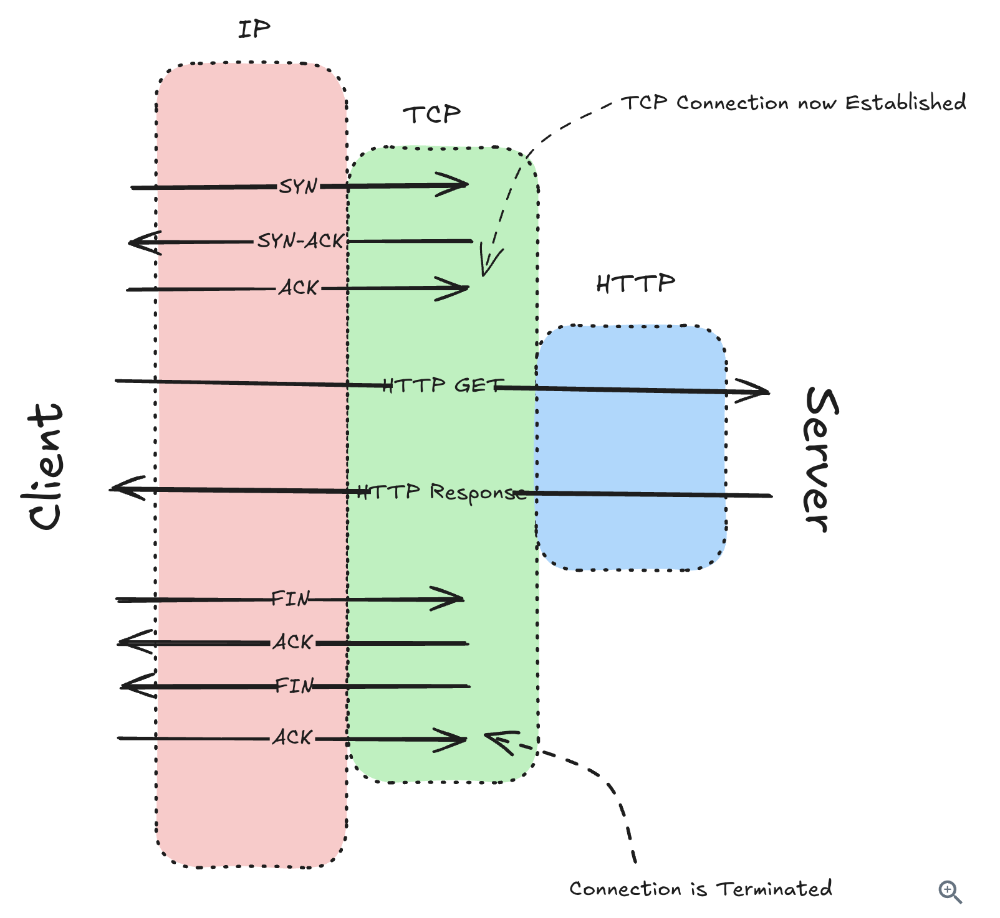

# SD - 现场5步模版

**Need → Things → Contract → Flow → Boxes → Risks**\
要什么 → 有什么对象 → 怎么调用 → 怎么流动 → 架构盒子 → 风险与优化

<figure><figcaption></figcaption></figure>

### Step 1: Requirements（约 5 分钟）

核心口诀：

> **What can users do? What must the system be good at? What scale matters?**\
> 用户能做什么？系统必须擅长什么？规模在哪里？

#### 1. Functional requirements：用户要做什么

<mark style="color:$warning;">只选最重要的 3 件事</mark>。句式固定为：Users should be able to ...

Short URL 例子：

1. Users should be able to create a short URL from a long URL.
2. Visitors should be able to open a short URL and be redirected to the original URL.
3. （可选）Users should be able to set an expiration time for a short URL.

面试现场可以说：

> I’ll focus on URL creation and fast redirection as the core flows. I’ll exclude&#x20;
>
> * User authentication and account management.
>
> &#x20;analytics as follow-up features if time permits.


Keep your requirements targeted! The main objective in the remaining part of the interview is to develop a system that meets the requirements you've identified -- so it's crucial to be strategic in your prioritization.


#### 2. Non-functional requirements：系统要“做得怎样”

<mark style="color:$warning;">只选三个</mark>。 不要说泛泛的 “highly scalable”。要说清楚：**哪个动作、达到什么标准、为什么重要。**

Short URL 例子：

* <mark style="background-color:$primary;">（先考虑CAP）</mark>Availability >> consistency：The system should be highly available: a short link should still work during partial failures.
* <mark style="background-color:$primary;">Uniqueness and Invariant (不变量）</mark>? Ensure uniqueness of short urls
* [<mark style="background-color:$primary;">Latency:</mark>](#user-content-fn-1)[^1]
  * Read latency on redirection (<100ms)， for example SLA with p99 under 100 ms.
  * Write Latency on url creation, should be reponsilve, can tolerance with p99 < 300-500ms
* <mark style="background-color:$primary;">Scalable</mark> to 1B urls and 100M DAU


还有一个可以callout 的characteristics： The System **read-to-write ratio**&#x20;

is the system heavily gravitate towards reads, as users frequently access shortened URLs, while the creation of new short URLs is comparatively rare.


> 话术；
>
> Regarding the CAP therom, Paritition tolerence is almost always the requirement for modern distributed system. I will certianly pick that first. Then the question becomes to "does our system need strong consistency or high availability? Mostly, I would question if a system need a strong Read after Write consistency? such that if our system is not reading the latest write updates, it breaks or fails in some ways. Example like banking, ticketing book the latest ticket.&#x20;
>
> For the nature of our system, its totally acceptable to have seconds or minutes of lagging/system refresh as long as we reached eventaul consistency. So, i am going to priorize High Availability >> consistency.


**Only PICK 3 that are most relevant to your system.**

1. **CAP Theorem**: Should your system prioritize consistency or availability? Note, partition tolerance is a given in distributed systems.
2. **Environment Constraints**: Are there any constraints on the environment in which your system will run? For example, are you running on a mobile device with limited battery life? Running on devices with limited memory or limited bandwidth (e.g. streaming video on 3G)?
3. **Scalability**: All systems need to scale, but does this system have unique scaling requirements? For example, does it have bursty traffic at a specific time of day? Are there events, like holidays, that will cause a significant increase in traffic? Also consider the read vs write ratio here. Does your system need to scale reads or writes more?
4. **Latency**: How quickly does the system need to respond to user requests? Specifically consider any requests that require meaningful computation. For example, low latency search when designing Yelp.
5. **Durability**: How important is it that the data in your system is not lost? For example, a social network might be able to tolerate some data loss, but a banking system cannot.
6. **Security**: How secure does the system need to be? Consider data protection, access control, and compliance with regulations.
7. **Fault Tolerance**: How well does the system need to handle failures? Consider redundancy, failover, and recovery mechanisms.
8. **Compliance**: Are there legal or regulatory requirements the system needs to meet? Consider industry standards, data protection laws, and other regulations.

#### 3. Capacity estimation：只算会改变设计的数字

Back the envolop estimations: 话术：

> **Regarding to the Capcity Estimation and Calculation, I will not to do the math upfront, I will do that math during my HLD and deep dives when I need to make a decision. So, my calculation can directly inform a design decision and its serving its purpose.**&#x20;

在我们的题目里，read-heavy 这个结论会直接导向：**cache / CDN + horizontally scalable storage**，所以值得算。

```
100M DAU
× 1 new URL per DAU per day
= 100M new URLs/day
≈ 1.2K write RPS

Read : Write = 100 : 1
= 10B redirects/day
≈ 116K redirect RPS
```

面试表达：

> We have about 1.2K average write RPS but roughly 116K average redirect RPS. This is a strongly read-heavy system, so the redirect path should be cache-first and horizontally scalable.

这一阶段结束时，你应该已经能清楚说出：

> **Build a durable URL mapping service where users create short links, and visitors are redirected with low latency and high availability at massive read scale.**


### Step 2: Core Entities（约 2 分钟

> **Core Entities = 系统世界里的核心名词(nouns, not verbs)。为了描述这个产品，哪些“人、物、关系、记录”是不可缺少的名词？**
>
> 话术：\
> I am not going to list off the full data model or any schema just yet, I will do that in my high level design for explicit rows, columns

#### Thinking pattern

1. **Who is involved?**\
   谁参与其中？\
   `User / Admin / Seller / Driver / Viewer ...`
2. **What is the main thing being created, viewed, changed, or consumed?**\
   用户围绕什么核心对象活动？\
   `Post / Order / Message / File / Booking ...`
3. **What relationship connects two core things?**\
   哪种“关系”本身需要被记录？\
   `Follow / Membership / Like / Assignment / Permission ...`
4. **What important event or record must exist?**\
   有什么关键事件或记录需要保留？\
   `Payment / Delivery / Notification / AuditEvent ...`

#### Output format

```
Actors:
- [actor 1]
- [actor 2]

Core entities:
- [main object]
- [relationship, if it must be stored]
- [important record/event, only if required]
```

#### Interview sentence

> Before jumping into the design, I’ll identify the core entities: the main actors, the primary resource, and any relationships or records that must be persisted. This is an initial model, and I’ll refine it as requirements become clearer.

### Step 3: API / System Interface（约 3 分钟

#### Goal

> **Turn each functional requirement into an external facing contract.**\
> 把每一条 functional requirement 变成客户端和系统之间的接口合同。

#### 1. Choose API type

```
Default: RESTful API via HTTP 
- External, resource-oriented APIs
- Standard CRUD operations

Use RPC when: Action-oriented protocol (like gRPC) that's faster than REST for service-to-service communication.
- You need a performance-focused internal service interface
```


**选择 REST：**

> The api interface is the contract layer we define between our client and server. For the external client-facing interface, I’ll use HTTP with a RESTful API design since the core operations are resource-oriented. I’ll now go through each functional requirement and define the minimum endpoint or endpoints required to support it, using our core entities as the request and response objects.

**选择 RPC：**

> For this latency-sensitive internal facing interface, the operation is primarily an action-oriented rather than resource-oriented, so I’d expose it as an RPC-style endpoint with explicit parameters and return values.

**需要实时推送时：**

> I’ll start with REST for the public API.  If later this feature requires the server to push subsequent updates to the client, so I’d add WebSockets or Server-Sent Events for the real-time channel. Or if the system requires a latency-critical internal call, I'd explicit with gRPC for server to server communication.&#x20;

#### 2. Fulfill each functional requirement

```
Create [Entity]      → POST /entities        /*用复数*/
Read [Entity]        → GET /entities/{id}
List/Search [Entity] → GET /entities?filters
Update [Entity]      → PATCH /entities/{id}
Delete [Entity]      → DELETE /entities/{id}
Business action      → POST /entities/{id}/action
```

举个例子：

For user management, we will assume user has logged in with email and passcode. For this POST operation, we will assume user identity comes from the verified `Authorization` header in the HTTP request.&#x20;

```
# user gives a long url and will return a short one. 
POST /urls  -> return 200 OK with "shorturl.com"
Authorization: Bearer <access_token>
{
  longUrl,
  alias?,
  expiredAt? # ISO timestamp
} 
```

The service looks up that code and returns `302 Found` with a `Location` header pointing to the original URL, so the browser redirects automatically.

```
GET /{shortcode} -> return HTTP 302 Found, with Location: https://originallongurl.com
   # Location is a standard HTTP response header
```

#### 3. Add comments only when needed

```
POST /v1/[resources]/{id}/[action]
# Explain what changes, whether it is synchronous,
# and what happens if the action was already performed.
```

### Step 4: High-Level Design（10–15 min)

<figure><figcaption></figcaption></figure>

#### Memory pattern

> **GOAL: Turn APIs into the smallest complete architecture.**\
> 把已定义的 APIs 变成一个能跑通的、最简单的端到端架构。
>
> Before I dive deep, I’ll first establish a high-level, black-box architecture to make sure we have a complete baseline that satisfies all core functional requirements. I’ll keep the components intentionally simple for now. Then, once the end-to-end flows are all set, I’ll come back to the most important non-functional requirements, constraints, and potential bottlenecks in the deep dives.


> **Draw → Trace → State → Strengthen → Park**\
> 先画 → 走请求 → 标状态 → 补约束 → 留深挖

#### 1. Draw: draw the simplest baseline

```
Client → Entry/API → Service → Primary Storage
```

先只画满足核心功能的最少组件。

> I’ll start with the simplest design that supports the core APIs, then evolve it only where requirements demand it.

#### 2. Trace: go API by API

对每个 core API，走一遍 happy path：Let me walk through the request flow for this API end to end.

```
Request enters where?
→ Which component handles it?
→ Which data does it read or write?
→ What response returns?
```

#### 3. State: say what changes and who owns it

每遇到 storage，就标注：

```
Entity / key & value:
- What is stored?
- Read or write?
- Which service owns this state?
```

> **Add components only for a reason:** 每加一个 box，都说：I’m adding \[component] because \[specific requirement / bottleneck].

```
Low-latency read   → Cache / CDN
Durable data       → Persistent DB + replication
Async side effect  → Queue + worker
Large objects      → Object storage
Search             → Search index
Real-time updates  → WebSocket / SSE
High traffic/data  → Partitioning / sharding
```


#### 4. Park: mark, don’t prematurely solve

发现复杂问题时，先标下来："This is an important trade-off; I’ll park it for a deep dive after the baseline is complete."

```
Deep dives:
- hot keys
- cache invalidation
- sharding
- retries / idempotency
- consistency
- failure handling
```

#### Final self-check

```
□ Every core API has an end-to-end request path.
□ Every important entity has a home in storage.
□ I stated what data is read or changed.
□ Every extra component has a clear reason.
□ I kept non-critical work off the critical path.
□ I identified 2–3 meaningful deep-dive risks.
```

### Step 5: Deep Dives（约 10 min）

**NFR + HLD parking lot → 找 bottleneck → deep dive**

```
1. Non-functional requirements (之前选好的）
2. HLD 时 parked 的 risks / open questions （选好的）
3. Product semantics / invariants：功能在边界条件下仍是否“正确”。
例如重复请求、并发修改、顺序、过期、删除、权限。这些不一定被完整写进 NFR，但常常决定系统是否正确。

4. Operational reality：系统上线后如何观测、扩容、降级、发布和控制成本。Senior/Staff 讨论里，这部分很容易拉开差距；但不必主动展开所有内容，只在它影响核心风险时提。资深面试框架普遍强调：选 2–3 个组件做压力测试、故障模式和成本/运行层面的推理，而不是泛泛罗列技术。
```

#### Goal

> **Proactively find and resolve the design’s highest-risk bottlenecks.**\
> 主动找出最可能让系统无法满足需求的地方，并讲清解决方案与取舍。

#### 1. Identify deep-dive topics

```
From NFRs:
- Low latency       → critical path, cache, tail latency
- High scale        → throughput, storage, hot keys, sharding
- High availability → failover, dependency failures, retries
- Strong correctness→ concurrency, duplicates, idempotency
- Durability        → replication, recovery, data loss
- Security          → auth, abuse, rate limit
```

```
□ Scale: throughput, storage growth, hot partitions/keys
□ Latency: critical path, sync calls, cache, tail latency
□ Correctness: duplicates, ordering, concurrency, idempotency
□ Availability: replicas, failover, dependency outage, retries
□ Data: durability, deletion/expiry, backup/recovery
□ Security: auth, authorization, abuse/rate limits
```

> Based on our requirements and the risks I parked during the high-level design, the highest-priority deep dives are \[X], \[Y], and \[Z]. They have the largest impact on user experience and system reliability.

#### 2. Provide solution and compare options

```
Problem:
- [...]

Option A:
- Benefit:
- Cost:

Option B:
- Benefit:
- Cost:

Decision:
- Choose [...] because it best satisfies [...]
```

> I’ll choose \[A] because it protects our most important requirement, \[X]. The trade-off is \[Y], which is acceptable because \[reason].

#### 5. Update: make the diagram reflect the decision

#### Senior-level habit

> **Do not just name a component. State the failure mode, the evidence/assumption, the chosen trade-off, and how the architecture changes. Use NFRs and parked questions to find risks; solve the few risks that determine whether the design succeeds.**

[^1]: Define 就好了， 不要包含计算。 计算留给HLD. Define 的时候default 用P99
